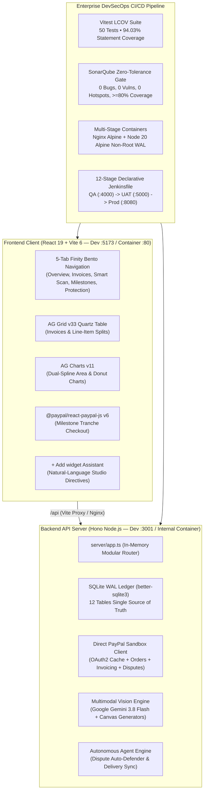

# PayPulse (v3 — Finity Matte Dark Bento Edition)
### Intelligent Split Payments, Milestone Escrow & Autonomous Seller Protection
**Built for the PayPal AI Hackathon: *Build What's Next with PayPal and AI***

[](https://paypalai.devpost.com/)
[](https://react.dev/)
[](https://vitejs.dev/)
[](https://hono.dev/)
[](https://www.ag-grid.com/)
[](https://www.ag-grid.com/charts/)
[](https://vitest.dev/)
[](https://www.docker.com/)
[](https://www.sonarqube.org/)
[](https://opensource.org/licenses/MIT)

---

## 1. Executive Summary & Value Proposition

**PayPulse** is a production-grade intelligent payment, milestone escrow, and automated seller protection platform. Built specifically for freelancers, digital agencies, merchants, and small businesses, PayPulse transforms high-friction payment workflows into a calm, automated experience:

* **Eliminates Invoice Math Errors:** Deterministic integer-cent split math (`splitAmountIntoCents`) calculates 30% / 40% / 30% tranche escrows without a single penny of rounding drift.
* **Solves Milestone Anxiety:** Transparent, multi-stage milestone escrow holding and releasing funds via `@paypal/react-paypal-js` v6 and PayPal Invoicing v2.
* **Proactive Chargeback Defense:** Autonomous AI Agent Playbooks monitor disputes and carrier deliveries (`DHL`, `FedEx`, `UPS`), automatically attaching verified SHA-256 evidence proofs to protect merchant funds under PayPal Seller Protection.
* **Multimodal Document Intelligence:** Multimodal AI Vision powered by Google Gemini 3.8 Flash parses paper receipts, PDF invoices, and physical waybills into structured line-item splits in seconds.
* **Finity Warm Matte Dark Bento Aesthetic:** Governed by `ui-ux-pro-max`, featuring a calm executive layout with `#141418` canvas, `#1E1E26` elevated Bento cards, 100% vector SVG icons (`lucide-react`, zero emojis), and 100% plain-English copywriting (zero developer jargon or telemetry clutter in user views).

---

## 2. High-Level System Architecture



---

## 3. Dedicated 5-Tab Workflow Architecture

PayPulse divides complex financial workflows across **5 focused tabs** with a floating left capsule icon rail, preventing single-screen cognitive overload:

| Tab | Finity Bento Components & Technologies | Key Capabilities |
| :--- | :--- | :--- |
| **1. Overview** | • 6-Card Executive Bento Workspace<br>• Smooth Dual-Spline Area Chart (`ag-charts-react` v11)<br>• Expense Distribution Donut Chart (`ag-charts-react` v11)<br>• Recent Transactions Ledger | Real-time balance aggregation, cashflow timeline filtering (`This Year`, `Last 6 Months`, `This Quarter`), instant deposit top-up modal, wire transfer modal, and payment card limit tracker. |
| **2. Invoices** | • Full-Width `ag-grid-react` v33 Table (`themeQuartz`)<br>• 30/40/30 Escrow Split Calculator<br>• Scan-to-Pay QR Code Modal<br>• Friendly Payment Reminders | Interactive sorting, filtering, and pagination across all invoices. Create invoices with automated 3-stage milestone escrow, generate instant payment QR codes, and trigger friendly email reminders. |
| **3. Smart Scan** | • Multimodal AI Vision (Google Gemini 3.8 Flash)<br>• 3 HTML5 `<canvas>` Real PNG Sample Generators<br>• Inline `ag-grid-react` v33 Line-Item Split Editor | Drag-and-drop receipts, invoices, or delivery waybills. Real-time OCR and line-item extraction with interactive cent adjustments and SHA-256 document proof generation. |
| **4. Milestones** | • Circular Tranche Progress Rings<br>• 30% / 40% / 30% Escrow Release Pipeline<br>• `@paypal/react-paypal-js` v6 Checkout Integration | Milestone deliverable review, client approval workflows, and instant tranche release to merchant balance backed by PayPal Orders & Capture APIs. |
| **5. Protection** | • Carrier Delivery Proofs (`DHL`, `FedEx`, `UPS`)<br>• Customer Disputes & Chargeback Ledger<br>• Autonomous Dispute Auto-Defender | Automated pairing of shipping tracking references with open dispute claims, instant seller protection evidence submission, and SHA-256 audit proof logging. |
| **`+ Add widget`** | • Natural-Language Workspace Assistant<br>• Studio Canvas Directive Engine (`StudioCanvasDirectiveSchema`) | Natural language commands (e.g., *"Show me open disputes and defend them"*, *"Review pending milestone"*) synthesize cross-tab directives and highlight target widgets. |

---

## 4. Production Tech Stack

* **Frontend (`src/`):** React 19, Vite 6 (`react-ts`), TypeScript 5.6+, Tailwind CSS v4 (`@tailwindcss/vite`), Lucide React (100% vector SVG icons, zero emojis), `@tanstack/react-query` v5.
* **Data Grid & Charts (Sponsor Target — $5,000 Best Use of AG Grid):**
  * `ag-grid-react` v33 (`ModuleRegistry.registerModules([AllCommunityModule])`, custom `themeQuartz.withParams` tuned to Finity `#1E1E26` matte dark).
  * `ag-charts-react` v11 (`AgCharts` smooth dual-spline area charts and thick rounded-cap donut charts).
* **Backend API (`server/`):** Hono v4 (`@hono/node-server`, `hono/cors`, `hono/logger`, `hono/body-limit` set to `15MB`), modular in-memory router (`server/app.ts`), TypeScript runtime via `tsx`.
* **Database & Persistence:** Embedded zero-config SQLite (`better-sqlite3`) with WAL journal mode (`PRAGMA journal_mode = WAL`) across 12 relational tables with automatic live seeding, foreign keys, and audit logging.
* **PayPal Developer Integration ($12,000 Grand Prize + $5,000 Agentic Commerce):**
  * `@paypal/react-paypal-js` v6 for client-side checkout.
  * Direct PayPal Sandbox REST API client (`OAuth2 Token Cache`, `Invoicing v2`, `Orders v2`, `Customer Disputes v1`, `Shipping Trackers v1`, `Reporting v1`).
  * Backend `paypal-debug-id` audit trail logging.
* **Multimodal AI Vision & Autonomous Agents:**
  * Vercel AI SDK (`ai`, `generateObject`) with Google Gemini 3.8 Flash Vision.
  * Deterministic Agent Playbook Engine (`server/services/playbooks.ts`).
* **Enterprise DevSecOps CI/CD:**
  * Vitest v5 (`@vitest/coverage-v8`, LCOV export, 94.03% statement coverage).
  * SonarQube Server (`sonar-project.properties` with strict zero-tolerance gate).
  * Multi-stage Dockerfiles (`Dockerfile.frontend` on Nginx Alpine, `Dockerfile.backend` on Node 20 Alpine with non-root user `node` and WAL volume permissions `775`).
  * Multi-environment Docker Compose (`QA :4000`, `UAT :5000`, `Prod :8080`, `CI :8085/:9000`).
  * 12-Stage Declarative `Jenkinsfile` pipeline.

---

## 5. How to Run PayPulse (Quickstart)

### Prerequisites
* **Node.js:** v20.12.0 or higher
* **npm:** v10.0.0 or higher
* **Docker & Docker Compose:** (Optional, for containerized execution)

---

### Option A: Local Development Mode (Recommended / Fastest)

The local development environment launches Vite (`:5173`) and Hono (`:3001`) concurrently with hot-module reloading and embedded SQLite WAL persistence:

```bash
# 1. Clone the repository
git clone https://github.com/RavishkaB2003/Paypal-AI-Hackathon-.git
cd Paypal-AI-Hackathon-

# 2. Install dependencies
npm install

# 3. Create your local environment file
cp .env.example .env

# 4. Start frontend and backend concurrently
npm run dev:all
```

* **Frontend Application:** Open **`http://localhost:5173`** in your browser.
* **Backend Healthcheck:** Query **`http://localhost:3001/api/health`**.

> [!TIP]
> **Zero-Friction Hackathon Evaluation:** PayPulse features a built-in **Deterministic Simulated Sandbox & Vision Fallback Engine**. Even if you run without providing external PayPal or Gemini API keys in `.env`, the entire application (invoicing, milestone escrow, dispute auto-defense, and bill scanning) functions seamlessly with rich, simulated responses!

---

### Option B: Production Container Deployment (Docker Compose)

Deploy the multi-stage, containerized production topology on port **`:8080`**:

```bash
# Build and launch production containers in background
docker compose -f docker-compose.prod.yml up -d --wait
```

* **Production Application:** Open **`http://localhost:8080`** in your browser.
* **Architecture:** Nginx Alpine reverse-proxying `/api` traffic to the non-root Node 20 Alpine backend with persistent SQLite WAL volume storage (`paypulse_prod_data`).
* **Tear Down:**
  ```bash
  docker compose -f docker-compose.prod.yml down
  ```

---

### Option C: QA Automated Testing Environment

Deploy the isolated QA container stack on port **`:4000`** (used as the target for automated Playwright E2E suites):

```bash
# Launch QA containers
docker compose -f docker-compose.qa.yml up -d --wait
```

* **QA Application:** Open **`http://localhost:4000`**.
* **Tear Down:**
  ```bash
  docker compose -f docker-compose.qa.yml down
  ```

---

### Option D: DevSecOps CI Stack (Jenkins + SonarQube)

Deploy local CI/CD infrastructure services:

```bash
# Launch SonarQube (:9000) and Jenkins (:8085)
docker compose -f docker-compose.ci.yml up -d --wait
```

* **Jenkins Orchestrator:** Open **`http://localhost:8085`**.
* **SonarQube Server:** Open **`http://localhost:9000`**.
* **Tear Down:**
  ```bash
  docker compose -f docker-compose.ci.yml down
  ```

---

## 6. Environment Configuration (`.env`)

Configure your `.env` file from `.env.example`:

```env
# ==============================================================================
# PayPulse Environment Configuration
# ==============================================================================

# PayPal Sandbox Developer Credentials
# Obtain from https://developer.paypal.com/dashboard/applications/sandbox
PAYPAL_CLIENT_ID=your_paypal_sandbox_client_id_here
PAYPAL_CLIENT_SECRET=your_paypal_sandbox_client_secret_here
VITE_PAYPAL_CLIENT_ID=your_paypal_sandbox_client_id_here
PAYPAL_ENVIRONMENT=sandbox

# Google Gemini AI Vision API Key
# Obtain from https://aistudio.google.com/
GOOGLE_GENERATIVE_AI_API_KEY=your_gemini_api_key_here
DEFAULT_VISION_MODEL=gemini-3.8-flash

# Server & Database
PORT=3001
SQLITE_DB_PATH=./data/paypulse.db
NODE_ENV=development
```

---

## 7. Automated Testing & Quality Assurance

PayPulse adheres to strict enterprise DevSecOps quality gates:

### 1. Run Vitest Unit & Coverage Suite ($\ge 80\%$ Gate)
Runs 50 unit, integration, and Hono in-memory route tests, outputting the coverage table and generating `coverage/lcov.info`:

```bash
npm run test:coverage
```

**Verified Coverage Results:**
```
-----------------|---------|----------|---------|---------|-------------------
File             | % Stmts | % Branch | % Funcs | % Lines | Uncovered Line #s 
-----------------|---------|----------|---------|---------|-------------------
All files        |   94.03 |    67.01 |     100 |   94.15 |                   
 server/db       |   98.33 |    79.41 |     100 |   98.33 |                   
 server/routes   |   94.42 |    66.19 |     100 |   94.36 |                   
 server/services |   87.23 |       50 |     100 |   87.23 |                   
 src/shared      |   92.72 |       75 |     100 |   94.23 |                   
-----------------|---------|----------|---------|---------|-------------------
```

### 2. Run Playwright End-to-End Browser Tests
Validates all 5 navigation tabs, interactive modals (wallet deposit, wire transfer, card linking), milestone tranche checkout, dispute defense, and asserts zero developer jargon in visible UI text:

```bash
# Headless Mode
npx playwright test

# Interactive Headed Browser Mode
npx playwright test --headed
```

### 3. Production TypeScript & Vite Build
```bash
npm run build
```
*Builds client bundles in `dist/` with 0 TypeScript or Vite warnings.*

---

## 8. 12-Stage Declarative Jenkins Pipeline (`Jenkinsfile`)

The enterprise Jenkins pipeline automates promotion across multi-container environments:

```
[1. Pre-Flight Audit] ➔ [2. Security Audit (npm audit)] ➔ [3. TypeCheck & Lint]
         ▼
[4. Vitest LCOV Gate (>=80%)] ➔ [5. SonarQube Quality Gate] ➔ [6. Container Packaging]
         ▼
[7. Deploy QA (:4000)] ➔ [8. Playwright E2E Verification] ➔ [9. Human UAT Gate]
         ▼
[10. Deploy UAT (:5000)] ➔ [11. Production Release Gate] ➔ [12. Deploy Prod (:8080)]
```

---

## 9. Official Hackathon Sponsor Target Matrix

| Sponsor Category | Award | Technical Proof & Implementation in PayPulse |
| :--- | :--- | :--- |
| **Devpost Grand Prize** | **$12,000** | Full-depth PayPal Developer Platform integration: Invoicing v2 (with QR codes & reminders), Orders v2 (milestone tranche captures), Customer Disputes v1, Shipping Trackers v1, SQLite WAL persistence, and 12-stage enterprise DevSecOps pipeline. |
| **Best Use of AG Grid** | **$5,000** | `ag-grid-react` v33 custom `themeQuartz` tuned to Finity `#1E1E26` matte dark tokens, responsive invoice dataset with status pills, interactive line-item split editing, and `+ Add widget` Smart Workspace Assistant. |
| **Best Agentic Commerce** | **$5,000** | Autonomous Dispute Auto-Defender, Delivery Tracker Auto-Sync to PayPal Seller Protection, and Natural-Language Studio Canvas Directive Engine (`StudioCanvasDirectiveSchema`). |

---

## 10. Repository Hygiene & Clean Security

* **Zero Credentials Stored:** Real API keys and credentials are never checked into version control. `.env*` files (except `.env.example`) are blocked by `.gitignore`.
* **Zero UI Telemetry Clutter:** Internal `paypal-debug-id` headers and raw hashes are stored purely in SQLite audit tables and backend JSON payloads, keeping the visible user interface calm, elegant, and 100% human-readable.
* **License:** Licensed under the permissive [MIT License](LICENSE).

---

**PayPulse** • *Built with ❤️ for the PayPal AI Hackathon 2026*
